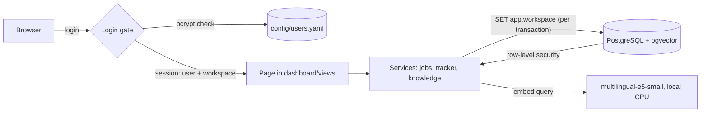

# Architecture

Career Intelligence Agent V2.0 is a single Streamlit application backed by one PostgreSQL database with pgvector. Everything runs locally in Docker Compose. Embeddings and scoring run on your machine; collectors fetch job postings only when you click *Fetch jobs*.

## Components

| Component | Implementation | Notes |
|---|---|---|
| UI | Streamlit multipage app (`dashboard/`) | `streamlit_app.py` is the only entry point: login gate, navigation, sidebar, footer. Pages live in `dashboard/views/`. |
| Translations | `dashboard/i18n/en.yaml`, `he.yaml` | `t("key")` helper; Hebrew switches the layout to right-to-left. |
| Authentication | `app/auth.py`, `dashboard/ui/auth_session.py` | bcrypt hashes in `config/users.yaml`; server-side session state; inactivity timeout; failed-login throttling. |
| Job pipeline | `app/collectors`, `app/matching`, `app/services/job_service.py` | V1 collection, deduplication, classic and career scoring — unchanged. Runs only when you click it. |
| Knowledge base | `app/rag/` | Chunking, local embeddings (`embeddings.py`), PostgreSQL store and retrieval (`workspace_knowledge.py`), TF-IDF fallback (`indexer.py`). |
| Tracker | `app/tracker/` | Vocabulary (`vocab.py`), Excel import/export (`excel.py`), CRUD and statistics (`service.py`). |
| Data | PostgreSQL 16 + pgvector (`app/db/`) | Pooled engine per process, workspace-bound sessions, idempotent migrations with row-level security. |

## Request flow

## Workspaces and isolation

- Each login maps to one **workspace**: `personal` (owner) or `demo` (synthetic data).
- Every table has a `workspace` column. `app/db/session.py` binds a workspace to each session and runs `set_config('app.workspace', …, true)` at the start of every transaction. New rows are stamped with the bound workspace before flush.
- `app/db/migrations.py` enables and **forces** row-level security on every table with the policy `workspace = current_setting('app.workspace', true)`. A session without a workspace sees no rows and cannot insert any.
- The application connects as `APP_DB_USER`: no superuser, no `BYPASSRLS`, no `CREATE`, and DML-only grants. It cannot drop tables or disable row-level security. Migrations run separately in the one-shot `migrate` service with the owner role.
- Filesystem inputs are resolved per workspace in `app/workspace.py`. The demo account reads only `demo/`. Streamlit caches that hold workspace data are keyed by workspace (and database URL).
- The workspace always comes from the authenticated user record, never from the URL, widgets or browser storage.

## Knowledge search

1. **Sync** (`ingest`): documents are loaded from the workspace folder, chunked, hashed (SHA-256) and embedded with `intfloat/multilingual-e5-small` (pinned revision, 384-dimensional, L2-normalised). Unchanged documents are skipped, changed documents are replaced and deleted documents are removed, all in one transaction.
2. **Vector search**: cosine distance over an HNSW index (`vector_cosine_ops`), filtered by workspace. Similarities are rescaled to `(sim − 0.80) / 0.20` (`VECTOR_SCORE_FLOOR`) so the existing confidence and coverage thresholds keep their meaning. Results at or below the floor are treated as irrelevant.
3. **TF-IDF fallback**: if the model cannot load, no chunk is embedded yet, or the vector query fails, an in-memory TF-IDF index is built from the same workspace's chunks (rebuilt only when they change). The tokenizer accepts Latin and Hebrew letters.

Job scoring (keyword, theme-based semantic and career decision engines) is unchanged from V1 and does not use the embedding model.

## Docker services

| Service | Role |
|---|---|
| `db` | `pgvector/pgvector:pg16`, named volume `pgdata`, `pg_isready` health check, port bound to `127.0.0.1` only. |
| `migrate` | One-shot `scripts/init_db.py` with the owner role: extension, tables, versioned migrations, RLS, app role. |
| `app` | Streamlit on container port 8508, published as **8086**. Starts after `db` is healthy and `migrate` has completed. Non-root user. Model baked into `/opt/models` (offline). |
| `tools` | Optional (`--profile tools`): runs `create_user.py` / `seed_demo.py` with a writable `config/` mount. |
