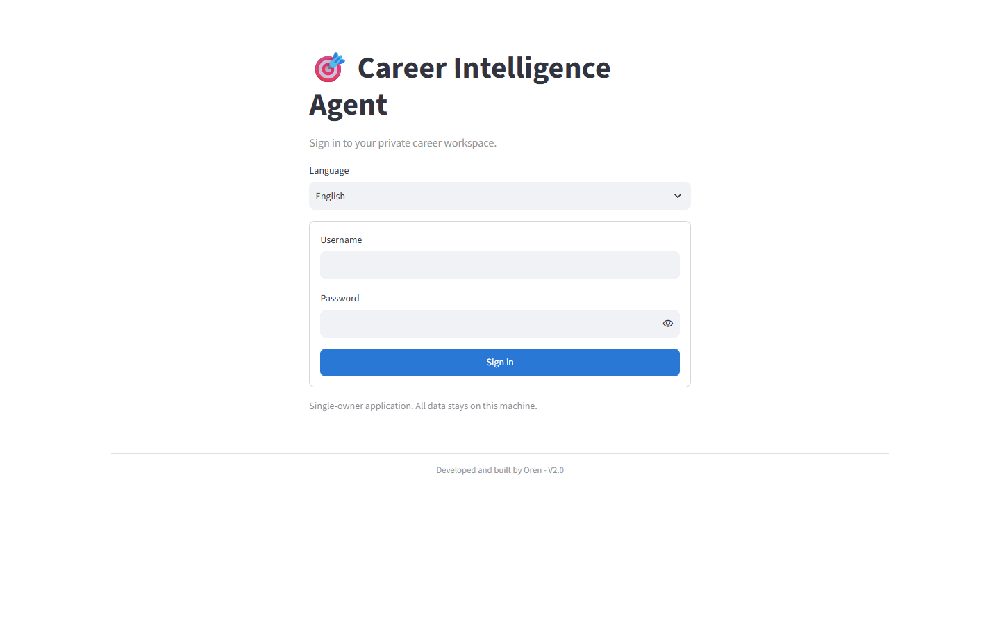
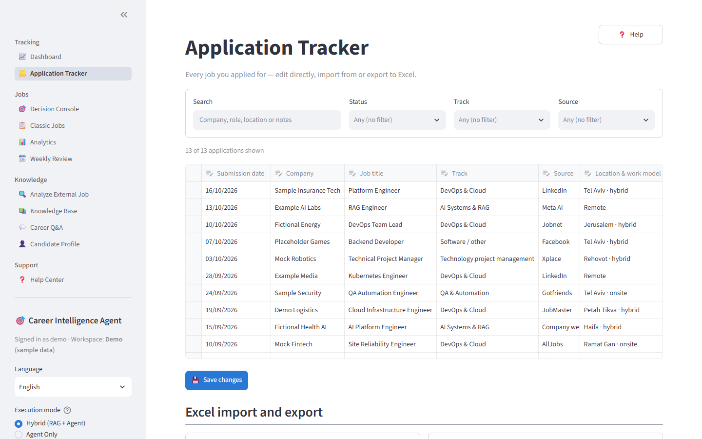
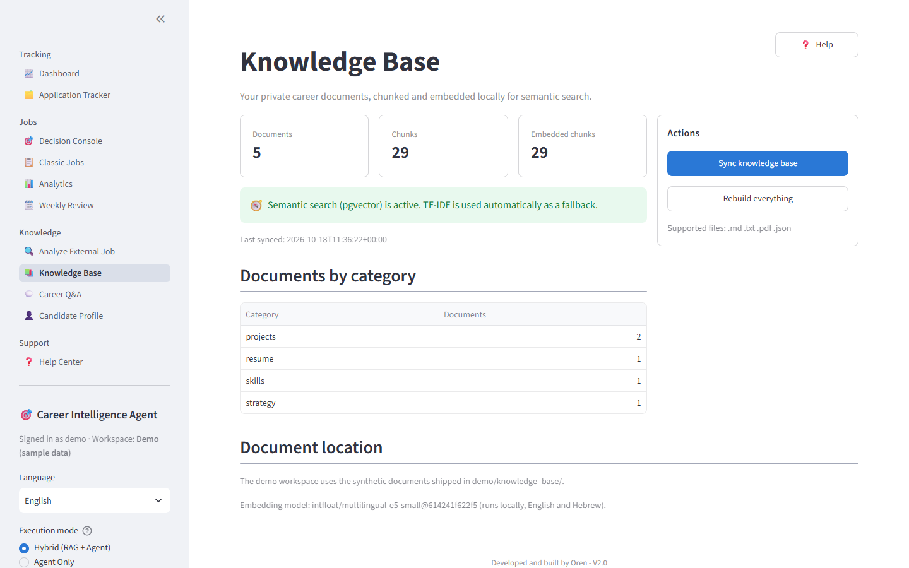
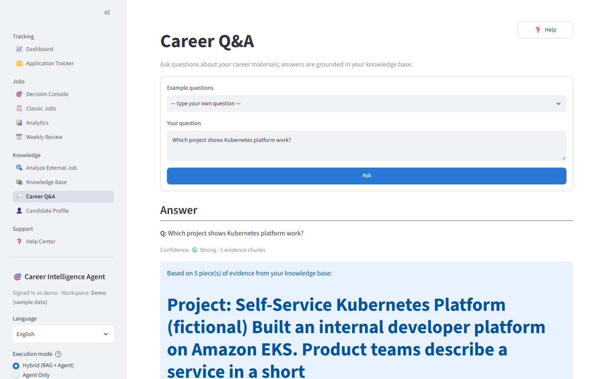
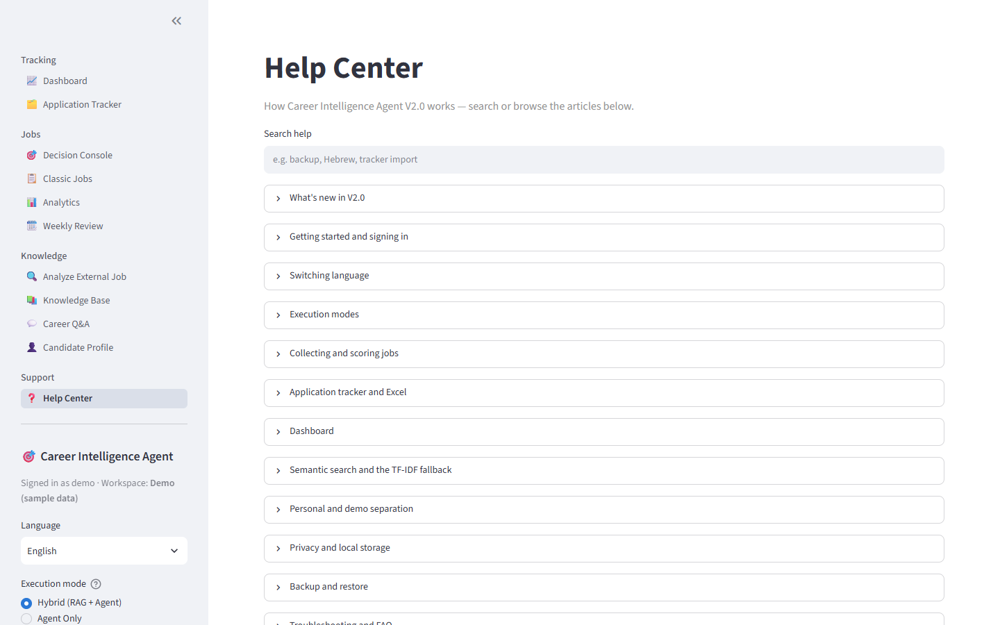

# User guide

The in-app **Help Center** (English and Hebrew) holds the same information, organised by task. This page is a short tour.

## Sign in

Sign in with your username and password. The language selector on this screen also applies after you sign in. Sessions end when you click **Log out**, after the inactivity timeout, or when you reload the page.

## Dashboard

KPIs and charts calculated from the Application Tracker. The four KPIs use the same definitions as the original workbook's dashboard sheet:

| KPI | Counts applications whose… |
|---|---|
| Total submitted | submission date is filled in |
| Active processes | status is Submitted, Under review, Initial call, Professional interview or Home assignment |
| Interviews scheduled | status is Initial call or Professional interview |
| Home assignments & offers | status is Home assignment or Offer / advanced |

The **pipeline funnel** counts, per stage, the dated applications whose current status is at that stage or later. Rejected and closed applications count only as submitted. **Needs follow-up** lists active applications whose last update is 14 or more days old. Imported rows start from their submission date. The date, track and source filters apply to every number on the page.

## Application Tracker

- Edit cells in place, add rows at the bottom and delete rows with the row checkbox, then click **Save changes**. A save is all-or-nothing: if any row is invalid (company and job title are required), nothing is written and the row is named in the error.
- **Import from Excel**: upload `Job_Search_Tracker.xlsx` (Hebrew) or an English export. A preview lists rows ready to import, duplicates, blank template rows, rows without company/role, invalid dates, values outside the lists and extra columns. Unknown values and columns are kept on the row (column *Kept from import*) and written back on export.
- **Export to Excel**: the same three sheets, dropdowns and formulas as the original workbook, in the current interface language.

## Jobs: Decision Console, Classic Jobs, Analytics, Weekly Review

Use **Job pipeline** to fetch jobs and run scoring. Nothing runs automatically. The Decision Console ranks jobs by fit score with strengths, gaps, action items and portfolio matches. Classic Jobs keeps the V1 keyword view. Analytics charts sources, labels and feedback. Weekly Review summarises the cycle.

## Analyze External Job

Paste any job description. The sidebar **Execution mode** decides what runs: Hybrid (scoring plus knowledge evidence), Agent Only (scoring) or RAG Only (evidence).

## Knowledge Base and Career Q&A

Click **Sync knowledge base** after changing documents in `knowledge_base/`. The page shows whether semantic (pgvector) or keyword (TF-IDF) search is active and why.

Career Q&A answers questions from your own documents, with sources and a confidence level. You can ask in English or Hebrew.

## Hebrew interface

Switch language in the sidebar. Your choice is remembered for your account. Only the interface is translated; your own data and engine-generated text are shown as they are.

## Help Center

Searchable articles in both languages. The **Help** buttons on individual pages open the matching article.
